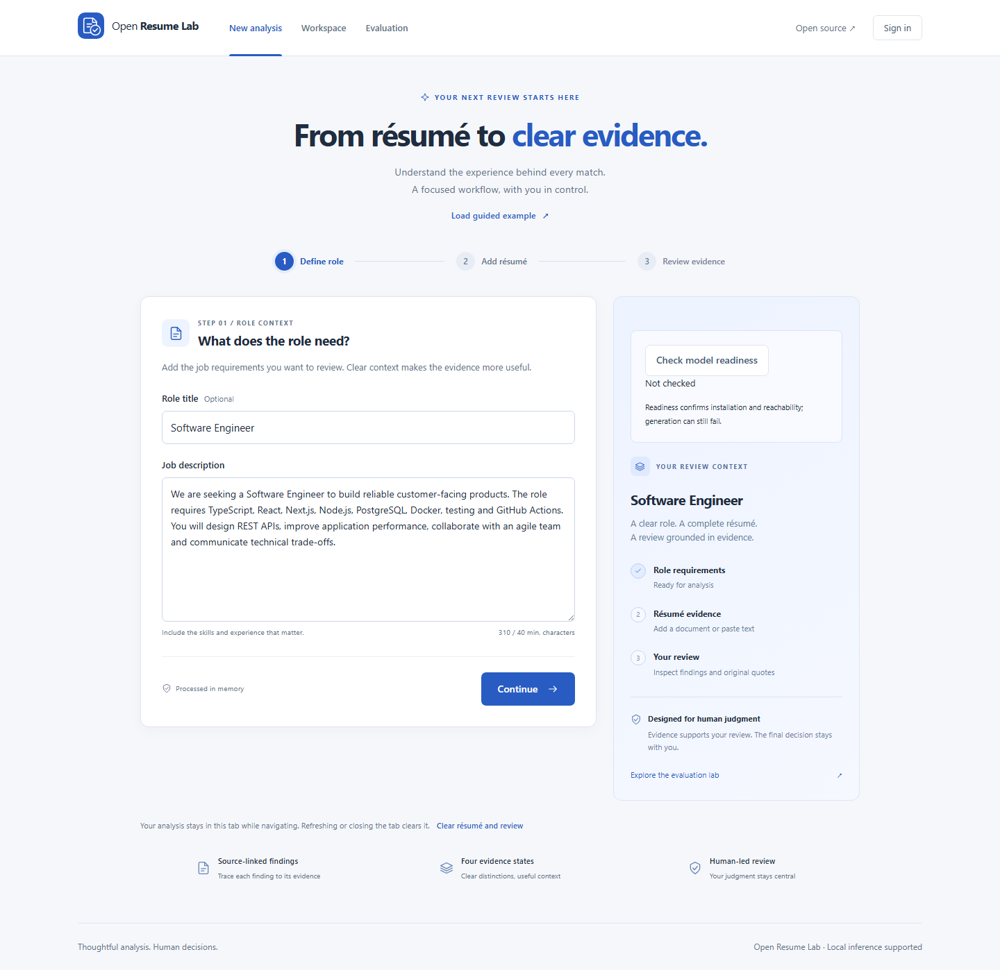
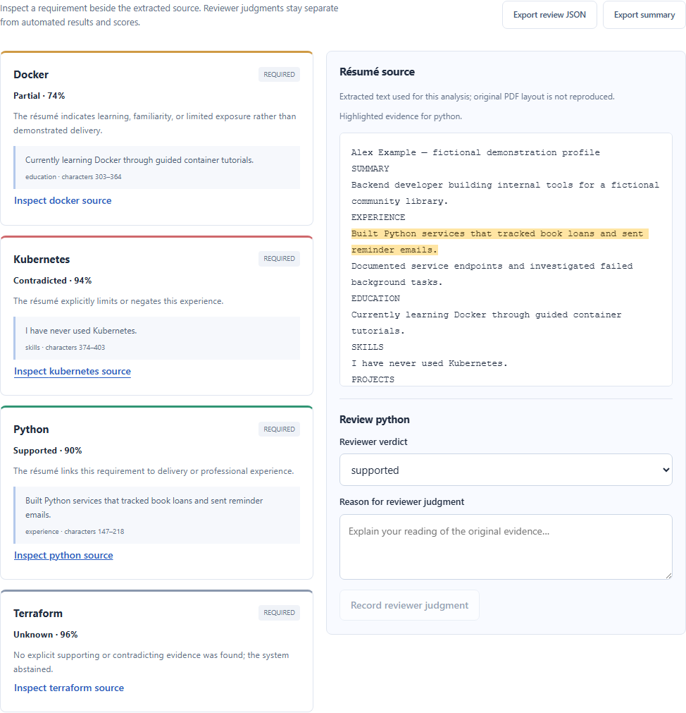
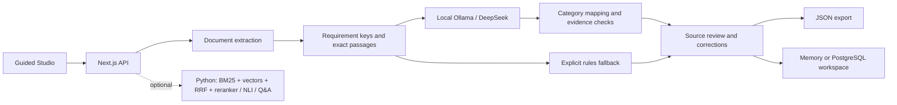

# Open Resume Lab

**Local résumé analysis with source-linked evidence and human review.**

Turn a job description and résumé into inspectable findings—not an automatic hiring decision. Open Resume Lab combines **DeepSeek-R1-Distill-Qwen-7B via Ollama**, versioned evidence checks, and a guided review workspace.



## See it in action

**Define role → Add résumé → Inspect evidence → Record a review → Export or save.**

[Watch the short offline walkthrough](docs/images/resume-lab-demo.webm) · [Follow the two-minute demo](docs/demo.md) · [Setup verification](docs/setup-verification.md)

The recording and screenshots use the bundled fictional example with AI disabled. The visible **Deterministic offline fallback** badge identifies that mode; DeepSeek results below come from separate recorded model runs.



## What makes it useful

- **Evidence before scores.** Inspect supported, partial, contradicted and unknown requirements against exact source passages. Original model judgments and check decisions remain available.
- **Human review that persists.** Record a correction and rationale, export review JSON, or save the original analysis to a workspace without another model call. Reviewer decisions remain separate from automated scores.
- **Local inference with visible diagnostics.** Ollama readiness, generation status, timing and fallback are explicit. Local processing depends on configured model, OCR and storage endpoints.
- **A complete review workflow.** Guided document input, PDF/DOCX/TXT and image support, candidate comparison, batch analysis and responsive layouts.
- **Reproducible evaluation.** Frozen inputs, paired raw/checked outputs, source hashes, per-case errors and historical failures. Optional Python hybrid retrieval, reranking, NLI and cited Q&A are separate from the core pipeline.

## Quick start: no model or database

Requires **Node.js 22.22+** and npm. Verification used Node 24.19.0 and npm 11.17.0 on Windows.

```sh
git clone https://github.com/laizhen1/ai-resume-screener.git
cd ai-resume-screener
npm ci
```

For a fresh checkout, copy the offline demo configuration:

```powershell
# Windows PowerShell
Copy-Item .env.demo.example .env.local
```

```sh
# macOS / Linux
cp .env.demo.example .env.local
```

If `.env.local` already exists, merge the demo settings instead of overwriting it.

```sh
npm run dev
```

Open **http://localhost:3000**, select **Load guided example**, then **Analyse match**. The demo disables AI, embeddings and the Python service, and uses process-memory storage with inline jobs. No model download, database or API key is needed. Workspace data disappears when the server stops. Use this authentication-disabled mode only on a private local machine.

Port occupied? Use `npm run dev -- --port 3102` and open that port instead.

## Enable local DeepSeek

Install Ollama, then edit these settings in `.env.local`:

```dotenv
ENABLE_LOCAL_AI=true
ENABLE_LOCAL_AI_ANALYSIS=true
OLLAMA_BASE_URL=http://127.0.0.1:11434
OLLAMA_MODEL=deepseek-r1:7b
OLLAMA_ANALYSIS_MODEL=deepseek-r1:7b
OLLAMA_ANALYSIS_TIMEOUT_MS=180000
OLLAMA_CONTEXT_LENGTH=8192
OLLAMA_MAX_TOKENS=4096
OLLAMA_THINK=true
```

```sh
# Separate terminal, only if Ollama is not already running
npm run llm:serve

# Pull only if the model is not installed (several GB)
npm run llm:pull
npm run llm:check
```

Restart Next.js after editing configuration. A successful analysis shows **AI analysis · deepseek-r1:7b**. A fallback badge is not a successful DeepSeek run. Keep optional reviewer summaries disabled for the shortest demo. See [DeepSeek configuration and diagnostics](docs/deepseek.md).

## Architecture



**Stack:** Next.js, React, TypeScript, Ollama; optional Python/PyTorch, PostgreSQL/pgvector and Redis. Engine **3.7.1** uses the **v13 passage contract**, **v8 boundary checks** and **checked-skills-v1** scoring. The skills component follows checked evidence; experience, impact and clarity remain uncalibrated model suggestions. [Architecture](docs/architecture.md) · [Scoring](docs/scoring-method.md) · [Privacy](docs/privacy.md)

## Actual measured results

Fresh local DeepSeek runs, recorded **2026-10-29**:

| Evaluation | Rules | Raw DeepSeek | With evidence checks |
|---|---:|---:|---:|
| V13 inspected regression set, 16 documents | 19/32 | 27/32 | **32/32** |
| V13 first-use targeted controls, 8 documents | 8/16 | 12/16 | **16/16** |
| Guided example, 1 document | 4/4 | 4/4 | **4/4** |

The final runs had **zero fallback and zero missing requirements**. Checked four-class macro F1 was **1.0000** on the inspected set and new controls. **214 unit tests, 15 browser tests, lint and production build passed.**

These small synthetic sets have agent-authored labels. The new controls use familiar failure mechanisms; they are not independent or family-disjoint validation. The earlier first-use probe remains **28/32 (87.5%, macro F1 0.8576)**, with all four failures preserved. Perfect regression scores do not establish hiring accuracy.

[V13 results, raw outputs and interrupted attempt](reports/deepseek-v13-results.md) · [Original first-use probe](reports/novel-generalization-v2.md) · [Full report history](reports/README.md)

## Development and optional services

```sh
npm test
npm run lint
npm run build
npx playwright install chromium
npm run test:e2e
```

Playwright starts its own offline server; stop a server already occupying port 3000, or set `PLAYWRIGHT_PORT` to another free port. Browser installation may download Chromium.

| Next step | Guide |
|---|---|
| Python retrieval, reranking, NLI and Q&A | [Model service](services/model-service/README.md) |
| Optional training and retrieval experiments | [Training and evaluation](docs/model-training.md) |
| PostgreSQL, Redis, Docker and authentication | [Operations](docs/operations.md) |
| Metrics, dataset provenance and review | [Experiments](docs/experiments.md) · [Independent review](docs/independent-review-guide.md) |
| Implemented work and remaining scope | [Project progress](docs/progress.md) |

Image OCR uses Tesseract.js. Scanned PDFs need a configured OCR service or conversion to images; model/OCR resources may require downloads. Optional Python models are not required for the quick start and were not the source of the V13 scores.

## Responsible use and license

Use fictional or appropriately consented data. Inspect the original evidence and keep employment decisions with a human; the system does not verify résumé claims or determine candidate suitability. Independent evaluation and calibration remain future work.

Apache License 2.0. See [LICENSE](LICENSE), [third-party notices](THIRD_PARTY_NOTICES.md) and [contributing](CONTRIBUTING.md).
