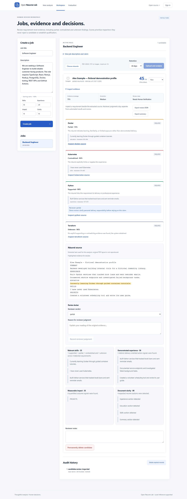

# Two-minute product walkthrough

Use the [offline quick start](../README.md#quick-start-no-model-or-database). This demo is reproducible without a model or database and uses only the bundled fictional résumé. [Watch the short recording](images/resume-lab-demo.webm).

| Time | Action | What to explain |
|---|---|---|
| 0:00–0:20 | Open the Studio and select **Load guided example**. | “A guided workflow brings the job requirements and résumé into one review.” |
| 0:20–0:40 | Select **Analyse match**. Point to the provider badge. | “This recording uses the offline rules path. A live local-model result is explicitly labeled `AI analysis · deepseek-r1:7b`.” |
| 0:40–1:00 | Inspect Python, Docker, Kubernetes and Terraform. | “Delivered work, limited learning, explicit denial and missing evidence are different states.” |
| 1:00–1:20 | Select **Inspect python source**. | “The reviewer can inspect the exact quote instead of trusting an explanation alone.” |
| 1:20–1:40 | Choose `partial`, enter a clarification request, and select **Record reviewer judgment**. | “This is a demonstration correction, not a benchmark relabeling. The automated result and score remain separate.” |
| 1:40–2:00 | **Export review JSON**, then **Save review to workspace → Open saved review**. | “The correction is exportable and retained in the workspace without another model call.” |

Suggested demonstration note: `Demo review: clarify personal delivery responsibility before relying on this claim.` Reload the saved candidate to show persistence within the running memory-mode server. Stopping the server clears that workspace; PostgreSQL is optional for persistence across restarts.



## Optional live DeepSeek demonstration

Follow [DeepSeek setup](../README.md#enable-local-deepseek), restart the server, and use the same guided example. Check model readiness before presenting. Leave room for generation: the latest guided run took about 40 seconds on the development machine, not a guaranteed latency. If a fallback badge appears, explain it honestly and continue the evidence-review workflow. Do not present the offline recording as model inference.

Show the [V13 report](../reports/deepseek-v13-results.md): inspected regression 32/32, first-use targeted controls 16/16, guided 4/4 after checks; raw controls 12/16. Explain that these are small agent-labeled synthetic sets and that independent evaluation remains outstanding. The historical first-use 28/32 result and failures remain available.

## Refresh screenshots and recording

With the offline configuration and a private local server running:

```sh
npx playwright install chromium
node scripts/capture-demo.mjs http://127.0.0.1:3000
```

The script checks the offline badge, all four verdicts, exact highlight, separate correction, export, workspace save, reload and mobile overflow. It uses the bundled fictional example only. It creates a memory-workspace entry and replaces the files in `docs/images/`; raw browser recordings go to ignored `test-results/`. Chromium installation may download a browser. No model calls or API mocking are used in the recording.

The exported review is validated during capture but is not published. Personal career documents and real résumés are not used.
